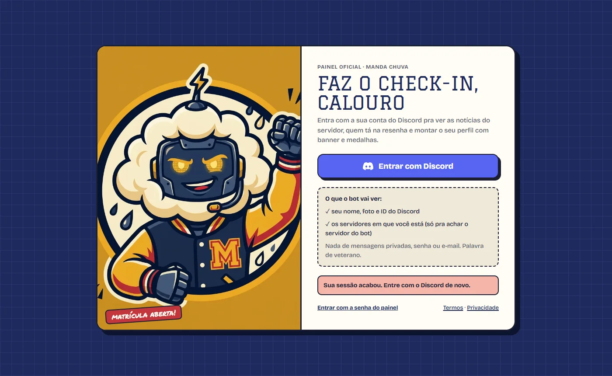
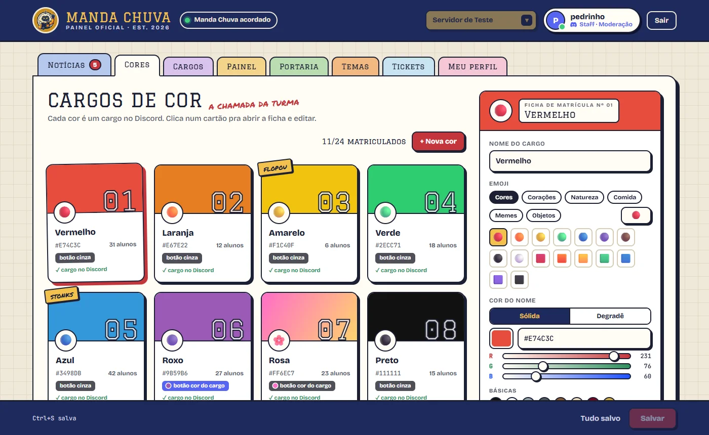
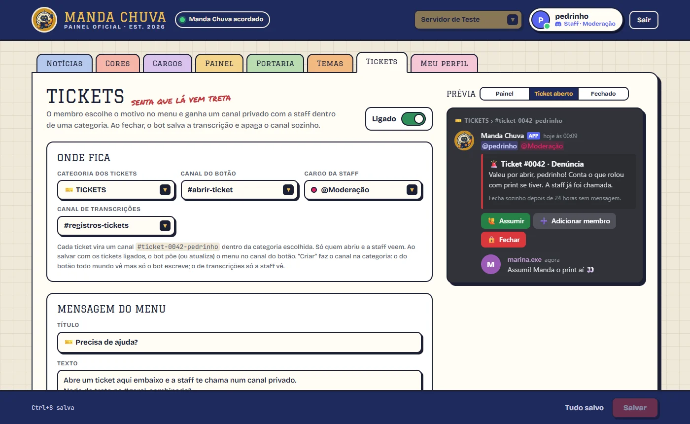
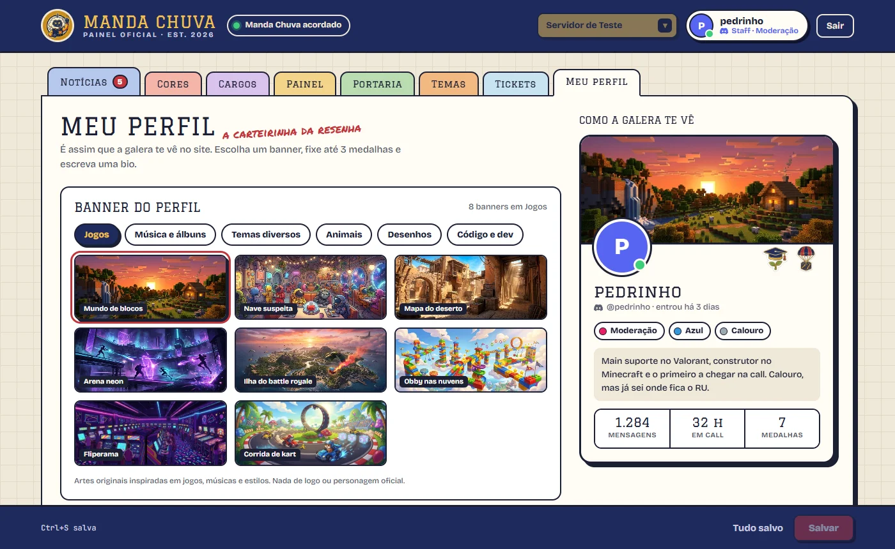
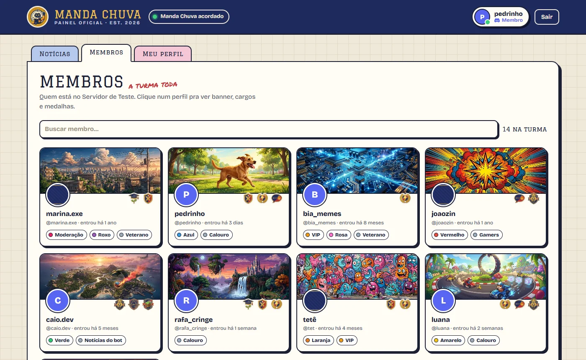
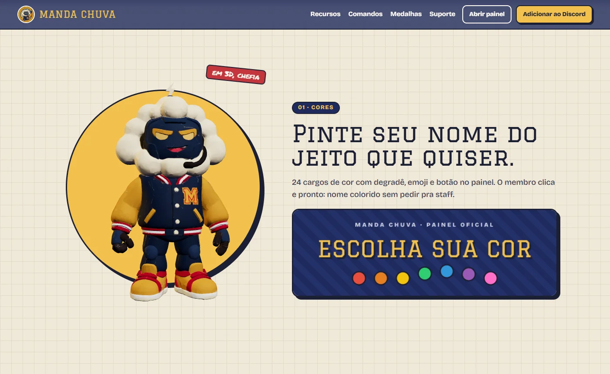
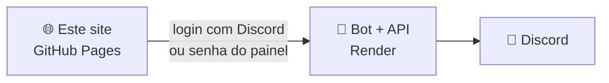

<div align="center">


# 🖥️ Painel do Manda Chuva

### O site do bot: painel da staff, perfil da galera e a Central do Bot

Visual "college" (papel de caderno, adesivos, sombras duras), login com o Discord e prévia de tudo do jeitinho que fica no Discord.

[](https://pedroa07.github.io/Interface-Manda-Chuva-Bot/)
[](#)
[](https://preactjs.com)
[](https://threejs.org)

**[🖥️ Abrir o painel](https://pedroa07.github.io/Interface-Manda-Chuva-Bot/painel.html)** &nbsp;·&nbsp;
**[🌐 Página inicial](https://pedroa07.github.io/Interface-Manda-Chuva-Bot/)** &nbsp;·&nbsp;
**[📘 Central do Bot](https://pedroa07.github.io/Interface-Manda-Chuva-Bot/central.html)** &nbsp;·&nbsp;
**[🤖 Repositório do bot](https://github.com/PedroA07/Manda-Chuva-BOT)**

</div>

---

## 📸 Telas

<table>
<tr>
<td width="50%"></td>
<td width="50%"></td>
</tr>
<tr><td align="center"><b>Check-in com o Discord</b></td><td align="center"><b>Cores</b>: cada cor é uma ficha de matrícula</td></tr>
<tr>
<td></td>
<td></td>
</tr>
<tr><td align="center"><b>Tickets</b> com prévia do Discord</td><td align="center"><b>Meu perfil</b>: banner, bio e medalhas</td></tr>
<tr>
<td></td>
<td></td>
</tr>
<tr><td align="center"><b>Membros</b>: a turma toda</td><td align="center"><b>Página inicial</b> com o mascote em 3D</td></tr>
</table>

## 🗂️ As abas

- **Cores**: os cargos de cor como cartões de matrícula. Cor sólida ou degradê, emoji por categoria, cor do botão (padrão do Discord, cor do cargo ou cor própria) e o boletim da hierarquia.
- **Painel**: texto, campos, imagens (banner em cima, miniatura, imagem grande e até 4 no final: modelos da galeria, link ou arquivo enviado), botões e respostas, com prévia ao vivo. Daqui também dá pra enviar o painel num canal.
- **Portaria**: mensagem quando alguém entra (com card de boas-vindas), sai, é expulso, banido ou silenciado: canal, modelos prontos, variáveis, texto dentro/fora, imagens, cargo automático, DM e "Testar comigo".
- **Temas**: as datas festivas (Natal, Ano Novo, Carnaval e Páscoa calculados, Junina, Halloween...), calendário, avisos personalizados, imagem do tema pra cada mensagem e "Simular uma data" pra ver as outras abas naquele dia.
- **Aniversários** (dentro de Temas): canal, horário, modelos, card do aniversariante, cargo de 24 h, DM, botão de cadastro no painel de cores, próximos aniversários e a lista completa (buscar, filtrar por mês, adicionar e tirar).
- **Tickets**: categoria, canal do menu e de transcrições (escolher ou mandar o bot criar), motivos, regras, fila de abertos e prévia em 3 etapas.
- **Meu perfil** e **Membros** (com login do Discord): banner, bio e medalhas fixadas; a turma toda com os cartões de perfil.
- **Notícias**: o Jornal do Campus com tudo que mudou no bot (filtros, não lidas) e onde o bot anuncia cada versão nova no Discord (canal, menção, imagens, "só as grandes").
- **Endereço do bot**: o endereço do serviço na Render (ex.: `https://manda-chuva-bot.onrender.com`), ou `http://localhost:3000` se o bot está rodando no seu PC.
- **Senha**: a `PAINEL_SENHA` configurada no bot. Se o bot roda no seu PC sem senha, deixe vazio.

## 🧱 Como funciona

É um site estático (HTML + JavaScript com [Preact](https://preactjs.com) embutido em `vendor/`, sem build). Ele não guarda nada: tudo fica no bot, e o site conversa com a API dele.



---

## 🛠️ Pra quem mexe no código

<details>
<summary><b>🗺️ Páginas</b></summary>

| Arquivo | O que é |
|---|---|
| `index.html` | Página inicial: hero com 48 quadros que andam com o scroll, recursos com o mascote em 3D (three.js), comandos, medalhas e convite. |
| `painel.html` | O painel: login com Discord (ou a senha do painel), abas da staff e, pra membros, Notícias, Membros e Meu perfil. |
| `central.html` | Central do Bot: Apresentação, Termos de Uso (`#termos`), Política de Privacidade (`#privacidade`), Suporte e checklist de verificação. Os links de Termos e Privacidade vão no Developer Portal do Discord. |

</details>

<details>
<summary><b>🔑 Como entrar</b></summary>

- **Entrar com Discord** (o jeito normal): o bot confere seu papel no servidor. Quem tem "Gerenciar servidor" vê tudo; quem tem o cargo da staff (aba Tickets) vê tudo menos a hierarquia; o resto vê Notícias, Membros e Meu perfil. Precisa do `DISCORD_CLIENT_SECRET` no bot (veja o README dele).
- **Senha do painel** (o jeito antigo, pro dono): clique em "Entrar com a senha do painel" e use o endereço do bot e a `PAINEL_SENHA`.

Com a senha, a interface pede:

- **Endereço do bot**: o endereço do serviço na Render (ex.: `https://manda-chuva-bot.onrender.com`), ou `http://localhost:3000` se o bot está rodando no seu PC.
- **Senha**: a `PAINEL_SENHA` configurada no bot. Se o bot roda no seu PC sem senha, deixe vazio.

Marcando "Lembrar neste navegador", ela não pergunta de novo. O botão **Sair** apaga a senha guardada.

</details>

<details>
<summary><b>⚙️ Configuração</b></summary>

- `config.js` tem o endereço padrão do bot, que já aparece preenchido na entrada. Troque pelo endereço que a Render mostrar.
- O site precisa estar liberado no `PAINEL_ORIGENS` do bot. O padrão do bot já libera `https://pedroa07.github.io`. Se você hospedar a interface em outro lugar (Vercel, Netlify...), coloque o endereço novo lá.

</details>

<details>
<summary><b>🧪 Testar no PC</b></summary>

Abrindo o `painel.html` direto (dando dois cliques) não funciona: precisa de um servidor. Por exemplo:

```
npx serve -l 5500
```

e abra http://localhost:5500. Aberta assim, ela usa `http://localhost:3000` como endereço padrão do bot.

Pra mexer no visual sem o bot, tem uma API falsa com dados de exemplo (serve o site junto):

```
node dev/api-falsa.mjs
```

e abra http://localhost:3000. Os testes das regras (paginação, cores, imagens, prévia) rodam com `npm test`.

A API falsa simula o login: "Entrar com Discord" volta como staff. Pra ver como membro, rode `PAPEL=membro node dev/api-falsa.mjs`; pra tirar os avisos de permissão dos prints, `DEMO=1 node dev/api-falsa.mjs`.

</details>

<details>
<summary><b>🚀 Publicar</b></summary>

O GitHub Pages publica sozinho a cada `git push` na branch `main` (Settings → Pages → Deploy from a branch → `main` / raiz).

</details>

<details>
<summary><b>🖼️ Imagens</b></summary>

A pasta `banners/` tem a galeria de modelos (banners animados das datas festivas, miniaturas, fundos de card e os clássicos). O bot usa essas imagens direto deste site, então elas precisam estar publicadas aqui.

</details>

---

<div align="center">


<sub>Feito com café do RU · EST. 2026 · <a href="https://pedroa07.github.io/Interface-Manda-Chuva-Bot/central.html#termos">Termos de Uso</a> · <a href="https://pedroa07.github.io/Interface-Manda-Chuva-Bot/central.html#privacidade">Privacidade</a></sub>

</div>
